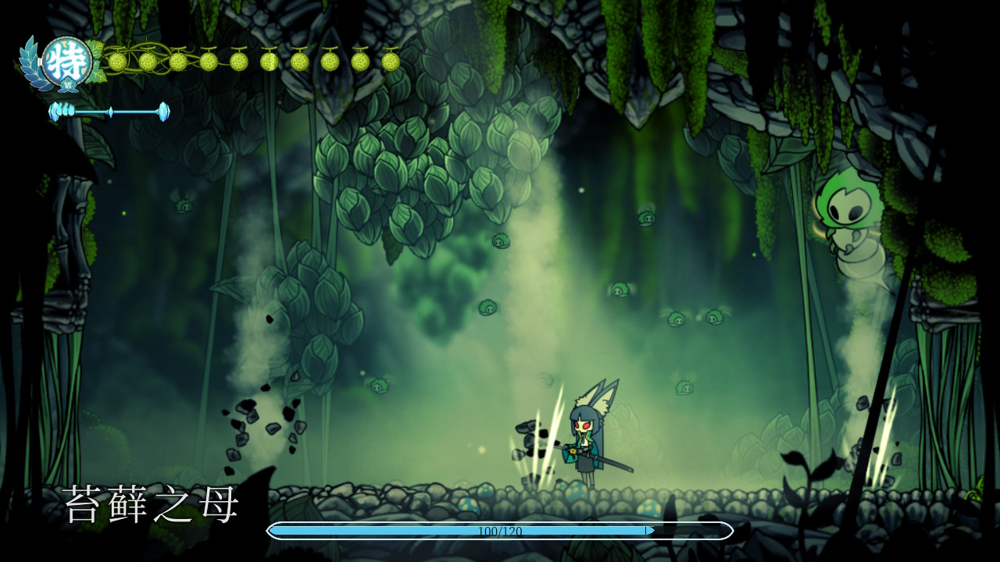
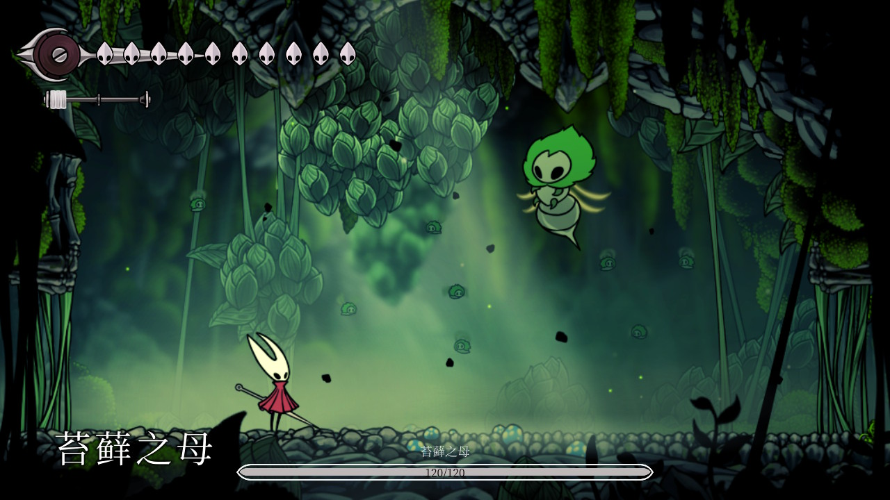
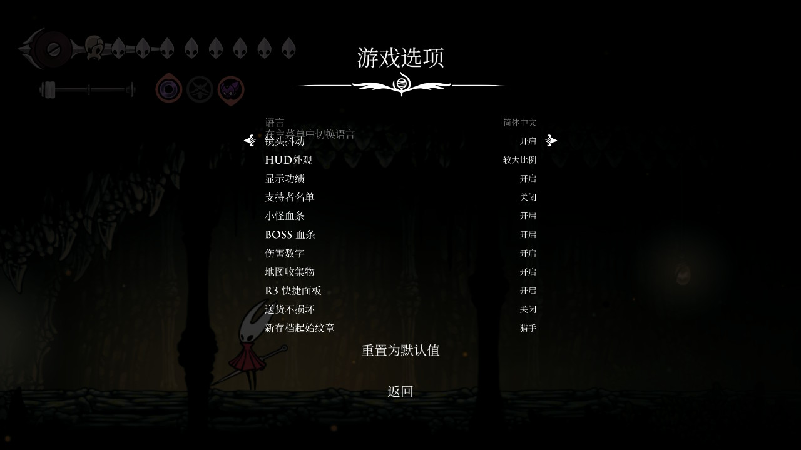
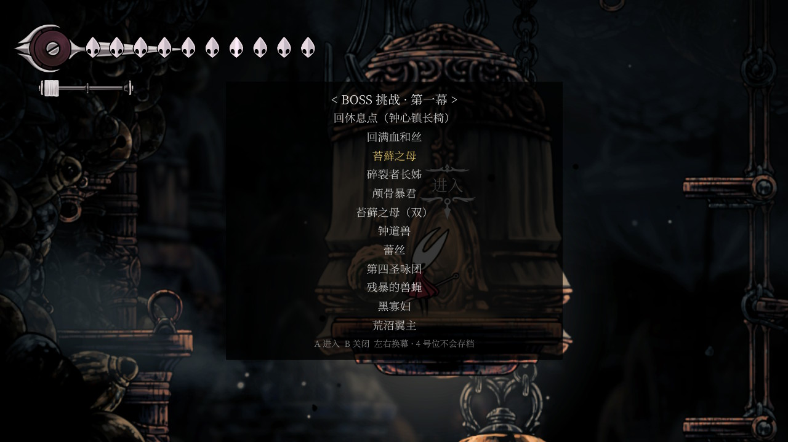

# NXModGold

在已破解的 Nintendo Switch 上，为《空洞骑士：丝之歌》补上 PC 端 mod 才有的 HUD 与地图功能。

[**下载 v1.0.9**](https://github.com/soul-cat/NXModGold/releases/tag/v1.0.9) · Switch 1 + Atmosphère · 仅支持游戏 v1.0.3

| 目标游戏 | Hollow Knight: Silksong **v1.0.3** |
|---|---|
| Title ID | `010013C00E930000` |
| 平台 | Switch 1（Erista / Mariko）+ Atmosphère；Ryujinx 也能加载同一份产物 |
| 注入方式 | exlaunch：`subsdk9` + 修补过的 `main.npdm`，经 Atmosphère exefs 注入 |

<table>
  <tr>
    <td width="50%"><br>
      <sub>安装皮肤 Mod 后，血条自动切成同一套青蓝配色</sub></td>
    <td width="50%"><br>
      <sub>BOSS 条整场常驻；左下角大字是游戏自己的标题</sub></td>
  </tr>
  <tr>
    <td width="50%"><br>
      <sub>「选项 → 游戏」页末尾新增的七行开关</sub></td>
    <td width="50%"><br>
      <sub>4 号位存档的 BOSS 挑战列表，选一场直达 BOSS 房</sub></td>
  </tr>
</table>

## 功能

| 功能 | 说明 |
|---|---|
| 敌人血条 | 受过玩家伤害的敌人头顶显示 `hp/maxHp`，最后一次掉血 1.5 秒后隐藏 |
| 伤害数字 | 受击处飘出红色 `-伤害`，2 秒内上升淡出 |
| BOSS 血条 | 最大血量 > 105 的敌人改画屏幕底部居中的 BOSS 条，多个向上堆叠；不按时间隐藏。分段加血的 BOSS（如苍白之母）合成整场一条显示 |
| 皮肤主题 | 检测到皮肤 Mod 时自动切换青蓝配色，血量 65% → 35% 平滑转暗红；没有皮肤时保持原配色 |
| 地图收集物 | 571 个（18 类）用游戏自带图标标在快速地图与大地图上；未收集、已买区域地图才显示 |
| 游戏内开关 | 原生「选项 → 游戏」页末尾七行 + 按住 R3 的快捷面板，共用 `SD:/config/sshud/config.ini` |
| 送货不损坏 | 信使送货的物品挨打、撞墙、硬着陆、计时、掉进危险地形都不掉耐久 |
| 新存档起始纹章 | 9 个纹章任选，只影响之后新开的存档；进第三幕不会强行换回猎人 |
| BOSS 挑战 | 只在 4 号位：按住 R3 + ZR 打开 45 场 BOSS 列表，选一场直接传送；该存档永不写盘 |
| 存档导出 / 导入 | 放一个触发文件，启动时把整个存档导出到 SD，或从 SD 导入 `user1..4.dat` |
| SD 日志 | `SD:/config/sshud/log.txt`，每次启动覆盖，排查问题先看它 |

## 安装

要求：已经跑 Atmosphère 的 Switch，游戏版本 **v1.0.3**（其它版本会自动不生效，不会影响正常游戏）。

**手动安装**：把发布包里的 `atmosphere/` 解压到 SD 卡根目录，最终文件是

```
SD:/atmosphere/contents/010013C00E930000/exefs/subsdk9
SD:/atmosphere/contents/010013C00E930000/exefs/main.npdm
```

**TOMOD**：直接在商店安装 —— [丝之歌 血条与地图 HUD](https://tomod.cn/mods/1409)。
本地 zip 安装时，包内需要是 `exefs/` / `romfs/` 这类目录结构；GitHub 发布包是给手动解压用的
`atmosphere/` 结构，两者不要混用。

**卸载**：删除上面的 `exefs/` 目录（同目录的金手指不要动），或在管理器里卸载。

> 想同时用 SilkModLoader 皮肤 Mod，请安装商店里的
> [丝之歌 × 星见雅皮肤（HUD 共存版）](https://tomod.cn/mods/1661)；
> 不要用商店里的原始皮肤包。两个包先装哪个都行，详见[皮肤与共存](#皮肤与共存)。

Ryujinx：右键游戏 →「打开 Atmosphere Mods 目录」，把 `exefs/` 放到 `<该目录>/sshud/exefs/`。

## 使用


| 操作 | 效果 |
|---|---|
| 按住 **R3**（右摇杆按下） | 弹出快捷面板 |
| 按住 R3 时按 **方向键** | ↑ 敌人血条 · → BOSS 血条 · ↓ 伤害数字 · ← 地图收集物 |
| 松开 R3 | 面板消失，设置写回 `config.ini` |
| 按住 R3 再按 **ZR** | 打开 BOSS 挑战列表（仅 4 号位存档） |
| 列表内 **A / B**、方向键 | A 进入、B 关闭；上下选 BOSS，左右换幕 |

也可以不进游戏：**「选项 → 游戏」页末尾**直接多了七行开关（小怪血条 / BOSS 血条 / 伤害数字 /
地图收集物 / R3 快捷面板 / 送货不损坏 / 新存档起始纹章），左右切换即生效，与 R3 面板共用设置。

**BOSS 挑战**建议在 4 号位放一个 100% 完成度的存档：菜单每页前两项固定是「回休息点」和「回满血和丝」，
其余是 45 场 BOSS；传送只改内存，4 号位存档文件在三层写盘处被拦下，重新读档即恢复原样。

**存档导出 / 导入**：在 `SD:/config/sshud/` 下放 `export.request` 空文件（导出）或 `import/user1..4.dat`（导入），
启动游戏首帧执行，结果写日志。

开关说明、纹章列表、收集物规则、已知限制等细节见 **[docs/usage.md](docs/usage.md)**。

## 皮肤与共存

皮肤 Mod（SilkModLoader）与本 Mod 默认会抢同一个 `exefs/subsdk9` 和 `main.npdm`。
商店里的[共存版皮肤](https://tomod.cn/mods/1661)只改了容器布局：皮肤运行时改名为 `subsdk8` 排在前面，
HUD 保持 `subsdk9`，两个包共用同一份 union npdm，内容逐字节相同，因此 TOMOD 不会报冲突。

装好后 HUD 会在启动时自动检测皮肤并切换配色，不需要额外设置。换皮肤包或卸载皮肤后重启游戏即可。
原理与实机验证记录：[docs/coexist-skin.md](docs/coexist-skin.md)。

皮肤资源版权归原作者 **终焉苍龙**（B 站）与 Switch 移植者 **nice2cu093**；
SilkModLoader / SilkRuntime 为 **GPL-2.0**，本项目只提供重新打包工具，未修改皮肤运行时与资源。

## 文档

| 文档 | 内容 |
|---|---|
| [docs/usage.md](docs/usage.md) | 完整使用说明：开关、纹章、BOSS 挑战、地图规则、存档导入导出、主题参数 |
| [docs/development.md](docs/development.md) | 开发文档：架构、目录、构建、测试、地址换算、工具流水线 |
| [HANDOFF.md](HANDOFF.md) | 接手文档：当前状态、实机验证清单、不变量、踩过的坑 |
| [docs/CHANGELOG.md](docs/CHANGELOG.md) | 版本变更 |
| [docs/coexist-skin.md](docs/coexist-skin.md) | 皮肤共存方案与验证记录 |
| [docs/tasks/](docs/tasks/) | 研究笔记（IL2CPP、绘制、收集物地图等，含已弃用路线） |

## 风险

- **Build ID 绑定**：游戏每次更新所有地址都会变。启动时校验 Build ID，不匹配就不安装 hook。
- **Switch 2 不适用**：目前没有公开可用的 CFW。
- **联机封号**：装 CFW mod 后不要联网，用 90DNS 或飞行模式。

## 法律边界

只对自己的主机、自己的游戏做转储与修改。游戏转储、`prod.keys`、`global-metadata.dat`、`dump.cs`、
`script.json` 以及由它们生成的 `offsets.h` / `collectibles.gen.h` 都不入库，`.gitignore` 已覆盖。
BOSS 条贴图为本项目自绘；面板文字贴图用 Noto Sans SC（SIL OFL）渲染。
