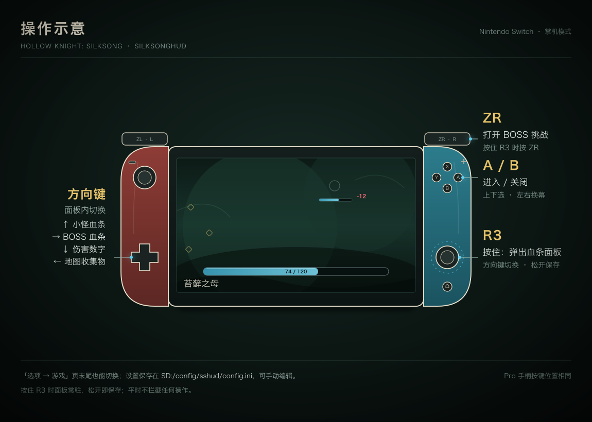

# 使用说明

## 操作一览

| 操作 | 效果 |
|---|---|
| 按住 **R3**（右摇杆按下） | 弹出快捷面板，面板里显示四个开关的当前状态 |
| 按住 R3 时按 **方向键** | ↑ 敌人血条 · → BOSS 血条 · ↓ 伤害数字 · ← 地图收集物 |
| 松开 R3 | 面板消失，设置写入 `SD:/config/sshud/config.ini` |
| 按住 R3 再按 **ZR** | 打开 BOSS 挑战列表（只在 4 号位存档可用） |
| BOSS 列表里 **A / B** | A 进入所选 BOSS，B 关闭；上下选人，左右换幕 |

R3 面板只读手柄状态，不拦截游戏输入；关掉「R3 快捷面板」开关后按住 R3 不再弹面板，
但 R3 + ZR 的 BOSS 列表不受影响。

## 开关

两处都能改，共用同一份 `config.ini`：

- **游戏原生选项页**：「选项 → 游戏」页末尾的七行，外观、字体与手柄导航和原生选项一致，左右切换即生效。
- **R3 面板**：游戏中随时可用，只能切换前四项。

| 选项页行 | `config.ini` 键 | 默认 | 说明 |
|---|---|---|---|
| 小怪血条 | `enemy_bars` | 开 | 受玩家伤害的敌人头顶显示血条与 `hp/maxHp` |
| BOSS 血条 | `boss_bar` | 开 | 最大血量 > 105 的敌人改画屏幕底部居中的 BOSS 条 |
| 伤害数字 | `damage_numbers` | 开 | 受击处飘出红色 `-伤害` |
| 地图收集物 | `map_markers` | 开 | 在地图上标出未收集的物品 |
| R3 快捷面板 | `quick_panel` | 开 | 关掉后按住 R3 不再弹面板 |
| 送货不损坏 | `protect_delivery` | 关 | 信使送货的物品不掉耐久、不会碎 |
| 新存档起始纹章 | `start_crest` | 0（猎人） | 0–8 九个纹章，只影响之后新开的存档 |

游戏语言为简体中文时显示中文标签，否则显示英文；开 / 关沿用游戏自己的本地化文字。
`config.ini` 每行 `key=0/1`，可以手动编辑，下次启动生效（R3 面板与选项页切换会立即写回）。

### 新存档起始纹章

九个纹章按顺序为：猎人（原版）、收割者、流浪者、野兽、女巫、建筑师、萨满、诅咒、无斗篷。
只改写「新开存档」时的初始状态，已经有存档不受影响。
进第三幕时游戏会强制装备猎人纹章；没有猎人的存档改为保持当前纹章。

## BOSS 挑战

只在 **4 号位**存档里可用，建议在那个位置放一个 100% 完成度的存档（所有 BOSS 都打过、已到第三幕）。
按住 R3 再按 ZR 打开菜单：上下选、左右换幕、A 进入、B 关闭。每页开头两项固定：回休息点（钟心镇长椅）、回满血和丝。

- 选 BOSS 后：先把上一个 BOSS 改过的标记还原成存档原值，再改这个 BOSS 需要的 PlayerData 标记与场景持久标记，
  复位时间流速，传送到 BOSS 房的门；到场后按表执行修正（激活 / 停用物体、给状态机发事件或跳状态）。
- 4 号位的所有存档文件（`user4.dat`、版本备份、`Restore_Points4/`）在最底层写盘处被拦下，游戏照常以为已存档；
  其他存档位不受影响。想恢复原状就回标题重新读档。
- 苍白之母、失心蕾丝的结局演出在到场时被停用，打完不会播结局。
- 部分 BOSS 需要互动才开打（加蒙德与扎扎：对话接受切磋；初罪者：神龛互动后按捆绑）；钟道兽、解体者打完会进丝之心回忆，
  黑寡妇、初罪者、回忆 BOSS、三叶草舞者打完会自动切场景——都只影响内存。
- 二见兽蝇暂未收录：它的场景分块由任务「Beastfly Hunt」状态决定。

BOSS 表的来源与调研方法（`tools/80-scan-boss-scenes.py`、`tools/81-dump-fsm.py`）见
[HANDOFF 的 BOSS 挑战资料](../HANDOFF.md#boss-挑战的资料与坑)。

## 地图收集物

571 个收集物（18 类）在快速地图与大地图上用游戏自带图标标出，规则与 PC 版 Completionist Map 一致：

- 没收集才显示；已收集的、区域地图没买的、房间没绘制的都不显示；
- 已向跳蚤商队猎人买了原生跳蚤图钉的区域，跳蚤交给游戏自己标，不重复画；
- 在同一个房间刚捡到的物品，开图前会先保存房间状态，标记立刻消失；
- 开关在下次打开地图时生效（标记只在开图时刷新）；
- 游戏自己的地图 pin 显示设为「无」时，收集物标记也一起隐藏；
- 图标按名字从已载入的资源里找，个别图标没载入时退回按分类染色的圆点，缺失的名字写进日志。

## 存档导出 / 导入

### 导出

在 SD 上创建空文件 `SD:/config/sshud/export.request`，启动游戏后首帧把整个 `save:/`（含 `Restore_Points*` 子目录）
复制到 `SD:/config/sshud/export/<n>/`（`n` 取第一个不存在的编号，旧导出不覆盖），然后删除触发文件。只读存档。

### 导入

把存档放到 `SD:/config/sshud/import/user{1..4}.dat`，启动游戏后首帧（在导出之后）：

1. 原 `save:/userN.dat` 备份到 `SD:/config/sshud/import/backup-userN.dat`；
2. 复制进 `save:/userN.dat` 并 `CommitSaveData`；
3. 导入文件改名为 `userN.dat.done`，下次启动不再重复。

每一步的结果都写进 SD 日志。

## 皮肤主题与共存

皮肤 Mod（SilkModLoader）同样占用 `exefs/subsdk9` + `main.npdm`，原始包不能和本 Mod 直接共存。
商店里的[丝之歌 × 星见雅皮肤（HUD 共存版）](https://tomod.cn/mods/1661)只改了容器布局：

| 文件 | 说明 |
|---|---|
| `exefs/subsdk8` | 皮肤运行时（原包的 `subsdk9` 改名；必须排在 HUD 前） |
| `exefs/subsdk9` | 本 HUD |
| `exefs/main.npdm` | 两个包**逐字节相同**的 union npdm（59 个 SVC，fs 全开） |
| `romfs/SilkModLoader/...` | 皮肤资源，原样 |
| `exefs_patches/SilkModLoader/*.ips` | 皮肤 IPS，原样（目标基址仍是 `main + 0x8A3A000`） |

TOMOD 的规则是「同路径 + 不同内容才冲突」，所以两个包的 `main.npdm` 内容相同时会走引用计数共享；
**先装 HUD 再装皮肤，或反过来，都可以**。不要再用商店里的原始皮肤包，也不要让皮肤 Mod 自动更新。
重新打包用 `tools/85-repack-skin-coexist.py`，原理与实机验证记录见 [coexist-skin.md](coexist-skin.md)。

启动时扫 rtld 模块表，检测到 `SilkModLoader` 就把血条切到皮肤配色，没有皮肤时保持原配色；
日志写 `[sshud] bar theme: skin` 或 `default`。换皮肤包或卸载皮肤后需要重启游戏。

| | 默认主题 | 皮肤主题 |
|---|---|---|
| 填充 | `#BEB8B8` | 青蓝 `#55C8F0` |
| 背景 | 深灰半透明 | 暗青 `#0A1418` |
| BOSS 外框 | 白 | 淡青 `#D8F4FF` |
| 低血量 | 不变色 | 65% → 35% smoothstep 过渡到暗红 `#C03050` |

两种主题都有填充顶部 1px 高光。BOSS 条上方不画名字，游戏自己的左下角大标题保持原样。
调色板与过渡区间在 `exl/program/hud_theme_model.hpp`。

## 日志

`SD:/config/sshud/log.txt`，每次启动覆盖。排查时先看这几行：

- `build id ... -> match` / `MISMATCH, hooks not installed`
- `hud build: theme-v3` 与 `bar theme: skin|default`
- `hooks installed`、`map hooks installed: 571 collectibles`
- `map: created=... visible=...`

## 已知限制

- 只支持游戏 v1.0.3（Build ID `FC9EA4CCC955D579`）；其它版本 HUD 不安装，游戏照常运行。
- 图标依赖已载入的资源，个别收集物可能退回圆点。
- 部分收集物（需要运行时查工具 / 典藏 / 纪念品状态的）暂未收录。
- BOSS 判定只看最大血量，大体型普通敌人也可能被当成 BOSS。
